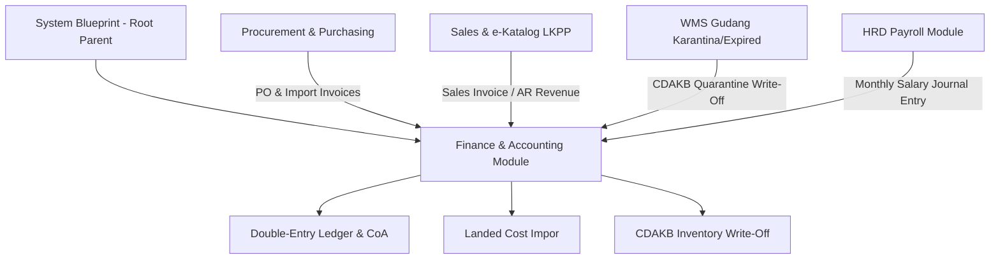

> **Status dokumen (2026-11):** **Sebagian** — jurnal berantai SHA-256, CoA, posting/void, dan kalkulator landed cost benar-benar diimplementasikan dan lolos tes (`tests/domain/akuntansi-*.test.ts`, `npm run test` = 189 tes hijau). Tetapi §2 (skema PostgreSQL `accounts`/`journal_entries`) adalah **desain target yang tidak pernah dijalankan**; data aktual tersimpan di `localStorage` browser, bukan di PostgreSQL/PocketBase — tidak ada server ledger sama sekali. Klaim "Real-time / Event-Driven Architecture" adalah aspirasi, bukan keadaan.

# Blueprint - Finance & Accounting / F&A (Child)

Status: **SELESAI & TERINTEGRASI KE PARENT SYSTEM BLUEPRINT**  
Parent Document: `/docs/system-blueprint.md` (Domain: Supporting System — Finance & Accounting)  
Sasaran Modul: `src/components/modules/supporting/FinanceModule.tsx` (beserta engine ledger double-entry, CoA, landed cost, dan CDABK write-off)  
Kerangka Regulasi: Standar Akuntansi Keuangan (SAK), CDAKB Permenkes RI 4/2014, ISO 13485:2016, Perpajakan RI (PPN 11%, PPh 22 Impor, e-Faktur), ALCOA+ Data Integrity.
Coded by Langgo Bramandityo

---

## 1. High-Level Enterprise Architecture & Integrasi Modul
Modul Finance & Accounting (F&A) REMEDI dirancang sebagai pusat pencatatan keuangan enterprise dengan pendekatan *Event-Driven Architecture* (EDA) untuk menjaga konsistensi data real-time lintas modul:
- **Modul Produksi / Manufaktur (ISO 13485)** ──> *(COGM / HPP Engine)* ──┐
- **Modul Gudang / WMS (CDAKB Karantina)**    ──> *(Inventory Valuation)* ┼─> **[Modul Finance & Accounting]**
- **Modul Sales & Distribution (SDAK)**     ──> *(AR / Invoice Engine)* ┘
- **CDAKB & SDAK Gate:** Setiap penjualan hanya dapat ditagih (*Invoiced*) jika nomor batch produk valid, tidak masuk daftar recall, dan didistribusikan ke fasyankes berizin.
- **ISO 13485 Gate:** Biaya Quality Control (QC), *scrap material* gagal, dan kalibrasi mesin otomatis dialokasikan ke Cost of Goods Manufactured (COGM) atau Biaya Operasional (BOP) spesifik.

---

## 2. Database Schema Design (PostgreSQL Enterprise)
Desain skema basis data relasional dengan indeks optimal untuk menjamin *traceability* dari jurnal umum hingga ke nomor batch alkes spesifik:

```sql
-- 1. Chart of Accounts dengan segmentasi cost center
CREATE TABLE accounts (
    account_id SERIAL PRIMARY KEY,
    account_code VARCHAR(20) UNIQUE NOT NULL, -- Contoh: 11301-001 (Persediaan Alkes Lokal)
    account_name VARCHAR(100) NOT NULL,
    account_type VARCHAR(30) NOT NULL, -- Asset, Liability, Equity, Revenue, Expense
    currency VARCHAR(3) DEFAULT 'IDR',
    is_active BOOLEAN DEFAULT TRUE,
    created_at TIMESTAMP DEFAULT CURRENT_TIMESTAMP
);

-- 2. Master Batch untuk CDAKB & ISO 13485 di sisi Finance
CREATE TABLE inventory_batches (
    batch_id SERIAL PRIMARY KEY,
    product_code VARCHAR(50) NOT NULL,
    batch_number VARCHAR(50) NOT NULL UNIQUE,
    manufacturing_date DATE NOT NULL,
    expiry_date DATE NOT NULL,
    is_quarantined BOOLEAN DEFAULT FALSE,
    is_recalled BOOLEAN DEFAULT FALSE,
    valuation_rate_per_unit NUMERIC(15, 4) NOT NULL
);

-- 3. Header Jurnal Umum (Append-Only Ledger)
CREATE TABLE journal_entries (
    journal_id BIGSERIAL PRIMARY KEY,
    transaction_number VARCHAR(50) UNIQUE NOT NULL, -- Contoh: JV-202611-0001
    transaction_date DATE NOT NULL,
    posting_date TIMESTAMP DEFAULT CURRENT_TIMESTAMP,
    reference_source VARCHAR(50) NOT NULL, -- 'INVOICE_SALES', 'MANUFACTURING_QC', 'WMS_SCRAP'
    reference_id INT NOT NULL,
    description TEXT,
    created_by INT NOT NULL,
    sha256_signature VARCHAR(64)
);

-- 4. Detail Jurnal (Debit / Kredit ber-Traceability Batch)
CREATE TABLE journal_items (
    item_id BIGSERIAL PRIMARY KEY,
    journal_id BIGINT REFERENCES journal_entries(journal_id) ON DELETE CASCADE,
    account_id INT REFERENCES accounts(account_id),
    debit NUMERIC(17, 2) DEFAULT 0.00,
    credit NUMERIC(17, 2) DEFAULT 0.00,
    batch_id INT REFERENCES inventory_batches(batch_id),
    cost_center_id VARCHAR(10), -- 'DIST' atau 'MFG'
    CONSTRAINT check_balanced_amounts CHECK (debit >= 0 AND credit >= 0)
);

CREATE INDEX idx_journal_date ON journal_entries(transaction_date);
CREATE INDEX idx_item_account ON journal_items(account_id);
CREATE INDEX idx_item_batch ON journal_items(batch_id);
```

---

## 3. Fitur Spesifik Keuangan Alkes (Regulasi & Kepatuhan)

### A. Automasi Valuasi Persediaan (CDAKB Karantina & Expired)
Menurut CDAKB, produk alkes kedaluwarsa atau rusak harus masuk karantina. Di aplikasi (`FinanceModule.tsx`), tombol **"Eksekusi Write-Off CDAKB"** secara otomatis menerbitkan jurnal:
- **(Debit)** Beban Kerugian Kerusakan & Kedaluwarsa Persediaan Alkes (Akun 61200-001)
- **(Kredit)** Cadangan Penurunan Nilai / Karantina (Akun 11400-000)

### B. Pajak & Landed Cost Impor Alkes
- **PPN 11%:** Otomatis terekam pada transaksi penjualan dan pembelian untuk integrasi pelaporan e-Faktur.
- **Landed Cost Impor:** Kalkulator HPP mengkapitalisasi Nilai FOB (USD), Bea Masuk (5%), PPN Impor (11%), dan PPh 22 Impor (2.5%) langsung ke dalam valuasi persediaan alat kesehatan.

---

## 4. Peta Tab & Implementasi UI (`FinanceModule.tsx`)

| # | Tab Akuntansi | Fitur Utama di Aplikasi |
| --- | --- | --- |
| 1 | **Jurnal Umum (Ledger)** | Pencatatan double-entry ber-SHA256 signature, validasi total debit == kredit, dan detail batch alkes per baris jurnal. |
| 2 | **Chart of Accounts (CoA)** | Direktori master akun terstruktur (Asset, Liability, Equity, Revenue, Expense) PT Anugrahmitra Selaras. |
| 3 | **Valuasi & Write-off CDAKB** | Tabel pemantauan batch aktif, status karantina/recall, serta tombol eksekusi jurnal penghapusan persediaan (*Write-off*). |
| 4 | **Landed Cost Impor Alkes** | Kalkulator interaktif HPP impor (FOB, Bea Masuk, PPN, PPh 22) dan riwayat pencatatan impor alat elektromedik. |
| 5 | **Laporan Laba Rugi & Segmen** | Laporan komparatif Pendapatan vs Beban serta analisis kontribusi segmen Distribusi (65%) vs Manufaktur (35%). |

---

## 5. Koneksi Lintas Modul (Parent-Child Integration)



1. **Procurement ke Finance:** Tagihan PO dan dokumen impor langsung terhubung ke kalkulator *Landed Cost* dan buku besar hutang.
2. **Sales ke Finance:** Setiap faktur penjualan (*Sales Invoice*) otomatis membukukan piutang dagang dan pendapatan penjualan.
3. **WMS Gudang ke Finance:** Batch yang masuk karantina atau kedaluwarsa memicu jurnal *Inventory Write-off*.
4. **HRD ke Finance:** Rekapitulasi *Payroll* bulanan otomatis mencatat jurnal beban gaji ke ledger.

---

## 6. Changelog & Versioning

| Versi | Tanggal | Deskripsi Perubahan |
|:--- |:--- |:--- |
| **v1.0.0** | 2026-11-05 | Inisialisasi cetak biru enterprise Finance & Accounting (F&A) mencakup skema PostgreSQL, Double-Entry Ledger, CDAKB Write-off, Landed Cost Impor, dan integrasi Parent-Child System. |

---
*Blueprint Finance & Accounting ini adalah spesifikasi baku yang mengikat seluruh pengelolaan keuangan pada AMS Integrated System (REMEDI).*
