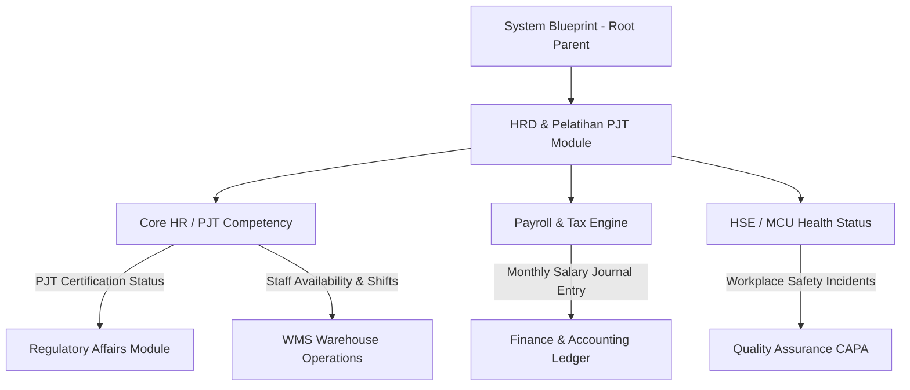

> **Status dokumen (2026-11):** **Sebagian** — kalkulator payroll (gaji pokok/173, PPh 21, BPJS), ambang sertifikat H-90, dan tabel temporal mutasi jabatan diimplementasikan dan ada tes (`payroll.test.ts`). Tetapi data HRIS aktual tersimpan di `localStorage` browser — **tidak ada** koleksi PocketBase `hris_employees`, `payroll_records`, `attendance_logs`, `capa_records`, atau `safety_incidents`; klaim tersebut tidak akurat. Absensi geofencing/GPS adalah UI, tidak ada verifikasi lokasi nyata. Tidak ada integrasi BPJS/DJP. Biometrik/foto tidak diproses (lihat `git-external.md`).

# Blueprint - Human Resource Information System (HRIS) & HRD Alkes (Child)

Status: **SELESAI & TERINTEGRASI KE PARENT SYSTEM BLUEPRINT**  
Parent Document: `/docs/system-blueprint.md` (Domain: Supporting System — HRD & Pelatihan PJT)  
Sasaran Modul: `src/components/modules/supporting/HRDModule.tsx` (beserta 7 sub-modul HRIS di `src/components/modules/supporting/hris/`)  
Kerangka Regulasi: Klausul 6.2 ISO 13485:2016 (Kompetensi Personel), Bab II CDAKB (Personalia), UU Ketenagakerjaan RI, UU Cipta Kerja, BPJS Kesehatan & Ketenagakerjaan, PPh 21.
Coded by Langgo Bramandityo

---

## 0. Ringkasan Eksekutif & Karakteristik Industri Alkes
Industri distribusi dan manufaktur alat kesehatan (PT Anugrahmitra Selaras / REMEDI) memiliki karakteristik operasional yang menuntut tingkat kepatuhan hukum (*regulatory compliance*) yang sangat tinggi:
1. **Kepatuhan Kompetensi (PJT & QC):** Personil kunci seperti Penanggung Jawab Teknis (PJT) wajib memiliki sertifikasi resmi (CDAKB, CPOAKB) dengan pemantauan masa berlaku ketat (ambang H-90).
2. **Dual-Environment Operasional:** Memadukan tenaga kerja pabrik manufaktur (sistem shift 24/7, cleanroom/steril, insentif yield produksi) dengan tenaga kerja kantor pusat dan mobile sales/distribusi (geofencing, absensi lapangan).
3. **Integritas Data Karyawan (ALCOA+):** Rekam medis kerja dan riwayat mutasi jabatan dikelola dengan prinsip tabel temporal (*system-versioned*) dan kerahasiaan data kesehatan.

---

## 1. Peta Fitur & 7 Sub-Modul Utama HRIS

| # | Sub-Modul HRIS | Berkas Utama | Fitur & Aturan Bisnis Aktual di Aplikasi |
| --- | --- | --- | --- |
| 1 | **Core HR & Org Management** | `CoreHRModule.tsx` | - Master data personil lintas 3 lokasi kerja (*Pabrik Manufaktur*, *Kantor Pusat*, *Gudang Distribusi*). - Visualisasi struktur organisasi multi-site. - Riwayat mutasi jabatan berbasis tabel temporal (`tanggalBerakhir = null`). - Pemantauan sertifikasi kompetensi (CDAKB, PJT) dengan ambang siaga H-90. |
| 2 | **Time & Attendance Management** | `TimeAttendanceModule.tsx` | - Penjadwalan shift fleksibel 24/7 untuk buruh pabrik. - Absensi geofencing & GPS untuk tim sales lapangan. - Kalkulator lembur otomatis sesuai formula UU Ketenagakerjaan (1.5x, 2x, 3x jam istirahat/hari libur). |
| 3 | **Payroll, Benefits & Tax Compliance** | `PayrollModule.tsx` | - Mesin penggajian otomatis (*Automated Payroll Engine*): gaji pokok + tunjangan kehadiran + insentif penjualan. - Kalkulator PPh 21, BPJS Kesehatan (4%), dan BPJS Ketenagakerjaan (JHT, JKK, JKM, JP). - Tunjangan khusus insentif yield produksi untuk buruh manufaktur. |
| 4 | **Strategic Recruitment (ATS)** | `RecruitmentModule.tsx` | - ATS dengan skrining kata kunci regulasi (misal: "CDAKB", "ISO 13485"). - Verifikasi lisensi & latar belakang kandidat (STR / sertifikasi teknis alkes). - Onboarding digital pakta integritas & standar higienitas pabrik. |
| 5 | **Learning & Competency (LMS)** | `LearningModule.tsx` | - Pelatihan mandatori CDAKB, CPOAKB, dan K3 Umum. - Notifikasi otomatis kedaluwarsa sertifikat personil kritis. - Matriks keterampilan operator mesin pabrik. |
| 6 | **Performance & Talent Management** | `PerformanceModule.tsx` | - Balanced Scorecard untuk staf kantor/sales (omset, kepuasan fasyankes). - Indikator efisiensi untuk manufaktur (OEE, Defect Rate). - Evaluasi berkala 360-Degree & Continuous Performance Management (CPM). |
| 7 | **HSE / K3 (Health, Safety & Environment)** | `HSEModule.tsx` | - Log pencatatan insiden kerja & *near-miss* di area pabrik/cleanroom. - Rekam Medical Check-Up (MCU) dengan status `Fit to Work` vs `Fit with Restriction`. - Pemantauan distribusi Alat Pelindung Diri (APD) medis. |

---

## 2. Stack Teknologi Modul HRIS

- **Frontend Stack**: React 19, TypeScript, Tailwind CSS v4, Lucide React, modal dialogs, tab navigasi reaktif, tabel multi-site.
- **State & Data Layer**: PocketBase collections (`hris_employees`, `payroll_records`, `attendance_logs`, `capa_records`, `safety_incidents`).
- **Engine / Logika Khusus**: 
  - Kalkulator Upah Per Jam (`Gaji Pokok / 173`).
  - Mesin Verifikasi Masa Berlaku Sertifikat (`statusSertifikat` & `hitungSisaHari`).
  - Mesin Tabel Temporal Mutasi Jabatan.

---

## 3. Koneksi Lintas Modul (Parent-Child Integration)

1. **HRD ke Finance & Accounting:** Rekapitulasi penggajian bulanan (*Payroll*) otomatis mengalirkan draf jurnal beban gaji ke modul *Finance & Accounting*.
2. **HRD ke Regulatory Affairs (RA):** Status keaktifan sertifikasi PJT dan SKP dikonsolidasikan dengan data penanggung jawab teknis perusahaan.
3. **HRD (HSE) ke Quality Assurance (QA):** Insiden keselamatan kerja atau hasil MCU kritis di area cleanroom manufaktur memicu investigasi CAPA di modul QA.
4. **HRD ke WMS & Sales:** Jadwal shift dan kehadiran personil memastikan ketersediaan tenaga operasional di gudang distribusi dan tim lapangan.

---

## 4. Changelog & Versioning

| Versi | Tanggal | Deskripsi Perubahan |
|:--- |:--- |:--- |
| **v1.0.0** | 2026-11-05 | Inisialisasi cetak biru HRIS komprehensif mengacu pada implementasi aktual 7 sub-modul HRD, regulasi CDAKB/CPOAKB/ISO 13485, dan integrasi Parent-Child System. |

---
*Blueprint HRIS ini adalah spesifikasi baku yang mengikat seluruh pengembangan sub-menu Human Resource Development pada AMS Integrated System (REMEDI).*
