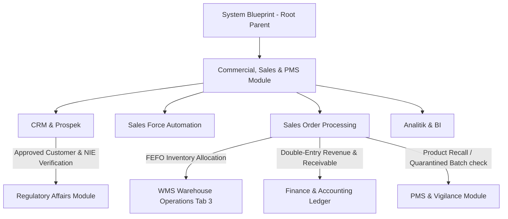

> **Status dokumen (2026-11):** **Sebagian** — alur order → alokasi FEFO sadar-kunci → stok → piutang diimplementasikan dan diuji (`npm run cek:fefo`). CRM/order/tender/kampanye bekerja di atas data contoh (seed) di `localStorage`. **Tidak ada** koneksi nyata ke LPSE/e-Katalog LKPP, SatuSehat, atau DJP — yang ada hanya antrean sinkronisasi + pratinjau payload (lihat blueprint Gudang). Klaim "LPSE Scraper & Alert System" dan "e-Katalog Pricing Engine live" adalah deskripsi UI/seed, bukan integrasi terverifikasi.

# Blueprint - Sales & Marketing / SDAK (Child)

Status: **SELESAI & TERINTEGRASI KE PARENT SYSTEM BLUEPRINT**  
Parent Document: `/docs/system-blueprint.md` (Domain: Commercial, Sales & PMS)  
Sasaran Modul: `src/components/modules/commercial/SalesModule.tsx` (beserta 7 sub-modul komersial di `src/components/modules/commercial/sales/`)  
Kerangka Regulasi: Permenkes Etika Promosi Alkes, CDAKB Permenkes RI 4/2014, Perpres Pengadaan Barang/Jasa Pemerintah (e-Katalog LKPP), ALCOA+ Data Integrity.
Coded by Langgo Bramandityo

---

## 0. Ringkasan Eksekutif & Karakteristik Industri Alkes
Sistem ERP komersial untuk manufaktur dan distribusi alat kesehatan (PT Anugrah Mitra Selaras / REMEDI) memiliki karakteristik unik:
1. **Validasi Kepatuhan Medis (CDAKB Validator):** Sales Order (SO) tidak dapat diproses jika nomor izin edar (NIE) alkes kedaluwarsa atau fasyankes tujuan tidak memiliki izin operasional yang sah.
2. **Keterikatan dengan e-Katalog LKPP & LPSE:** Sebagian besar volume penjualan institusi pemerintah dikelola melalui kontrak harga e-Katalog dengan manajemen margin dan pagu kredit (*Credit Limit & TOP*) yang ketat.
3. **Eksekusi FEFO Sadar-Kunci:** Transaksi penjualan langsung terintegrasi dengan mesin alokasi stok gudang FIFO/FEFO untuk memastikan batch kedaluwarsa terdekat atau batch terkarantina tidak pernah terpilih.

---

## 1. Peta Fitur & 7 Sub-Modul Utama Komersial

| # | Sub-Modul Komersial | Berkas Utama | Fitur & Aturan Bisnis Aktual di Aplikasi |
| --- | --- | --- | --- |
| 1 | **CRM & Management Prospek** | `CrmProspekModule.tsx` | - Pemetaan B2B Customer Profiling (RS Pemerintah/Swasta, Klinik, Apotek, Dinkes). - Pelacakan lead & opportunity pipeline dari perkenalan hingga negosiasi. - Pemetaan area wilayah kerja MedRep (Sales Territory Mapping). |
| 2 | **Manajemen Tender & Kontrak** | `TenderKontrakModule.tsx` | - LPSE Scraper & Alert System untuk tender aktif. - Contract & Pricing Agreement untuk mengunci harga tender jangka panjang. - Margin Calculator untuk kalkulasi profitabilitas bersih. |
| 3 | **Otomasi Sales Force (SFA)** | `SalesForceModule.tsx` | - Visit Planner & Geo-Tagging untuk absensi kunjungan fasyankes berbasis GPS. - Product Knowledge & Digital Brosur (akses spek teknis & NIE). - Mobile Order Taking (Pre-Order langsung dari lapangan). |
| 4 | **Manajemen Order & Penjualan** | `SalesOrderModule.tsx` | - Izin Edar & Compliance Validator (penolakan otomatis jika NIE kedaluwarsa). - Multi-Level Pricing & Discount Engine (diskon kuantitas & bonus sampel). - Credit Limit & TOP Control (blokir otomatis jika piutang melewati jatuh tempo). - Eksekusi alokasi stok FEFO sadar-kunci ke modul WMS. |
| 5 | **Marketing, Promo & Campaign** | `KampanyeMarketingModule.tsx` | - Event & Simposium Manager (seminar kedokteran & pameran alkes). - Sample & Demo Unit Tracking (peminjaman unit alat ke RS untuk uji coba). - Loyalty & Rebate Program (bonus akhir tahun fasyankes pencapai target). |
| 6 | **Newsletter & Mailing List** | `ListmonkModule.tsx` | - Kampanye email pemasaran, buletin regulasi Kemenkes, dan pengumuman pembaruan e-Katalog kepada mitra fasyankes. |
| 7 | **Analitik & Dashboard (BI)** | `AnalitikSalesModule.tsx` | - Sales Performance Dashboard (analisis per sales, per produk, per wilayah). - Demand Forecasting prediktif untuk mencegah stockout/overstock di gudang/pabrik. |

---

## 2. Core Architecture & Database Strategy
- **Arsitektur:** Modular Monolith siap scale-out, di mana modul Sales terintegrasi erat dengan *Inventory (WMS)* dan *Procurement*.
- **Database Partitioning & Master-Slave:** PostgreSQL dengan partisi tabel berdasarkan wilayah distribusi dan rentang waktu transaksi.
- **Audit Trail (ALCOA+):** Setiap perubahan harga, diskon, pagu kredit, dan status SO wajib mencatat log (User, Timestamp, Old Value, New Value).

---

## 3. Stack Teknologi Modul Sales
- **Frontend Stack**: React 19, TypeScript, Tailwind CSS v4, Lucide React, SFA interactive maps/geo-tagging UI, modal form builders.
- **State & Data Layer**: PocketBase CRM & Sales Collections (`sales_orders`, `customers`, `tenders`, `campaigns`).
- **Engine / Logika**: e-Katalog Pricing Engine, CDAKB Compliance Validator, FEFO Order Allocation, Landed Margin Calculator.

---

## 4. Koneksi Lintas Modul (Parent-Child Integration)

1. **Sales Order ke WMS Gudang:** Pembuatan Sales Order memicu mesin alokasi FEFO di modul Gudang dan mengurangi stok fisik secara real-time.
2. **Sales Order ke Finance & Accounting:** Setiap SO yang disetujui otomatis menghasilkan piutang dagang (*Accounts Receivable*) dan jurnal pendapatan di buku besar.
3. **Sales ke Regulatory Affairs:** Validasi nomor izin edar (NIE) terhubung langsung dengan master data registrasi Kemenkes di modul RA.
4. **Sales ke PMS & Vigilance:** Riwayat pembelian fasyankes pada Sales Order menjadi acuan penarikan produk (*product recall*) jika terjadi insiden di lapangan.

---

## 5. Changelog & Versioning

| Versi | Tanggal | Deskripsi Perubahan |
|:--- |:--- |:--- |
| **v1.0.0** | 2026-11-05 | Inisialisasi cetak biru komprehensif modul Sales & Marketing / SDAK mencakup 7 sub-modul, regulasi etika promosi alkes, CDAKB validator, dan integrasi Parent-Child System. |

---
*Blueprint Sales & Marketing ini adalah spesifikasi baku yang mengikat seluruh pengembangan komersial pada AMS Integrated System (REMEDI).*
