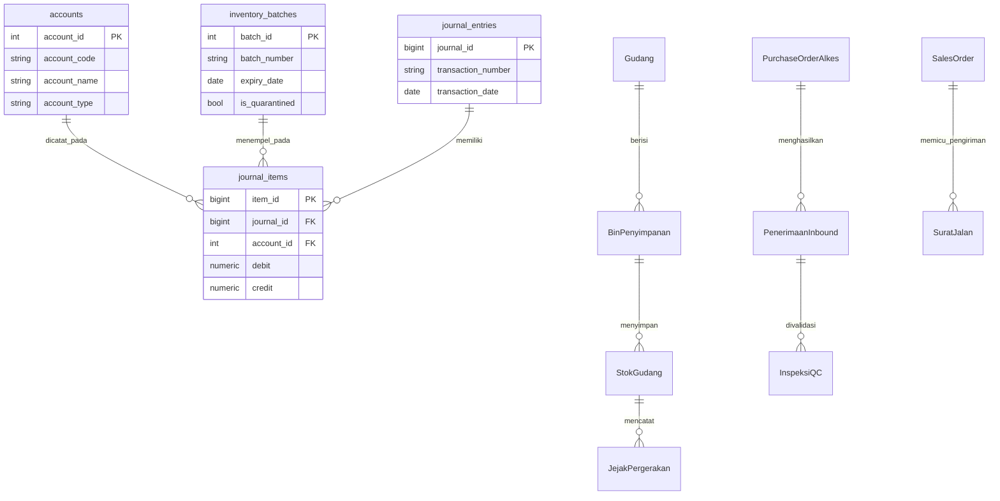

> **Status dokumen (2026-11): DESIGN TARGET — BELUM DIIMPLEMENTASIKAN.** Arsitektur di dokumen ini adalah rencana, bukan keadaan yang berjalan. Yang benar-benar berjalan hari ini: modular monolith front-end (React) dengan data di `localStorage`, plus server Express hanya untuk snapshot situs web (`/api/website/published`) dan file statis. **Tidak ada PostgreSQL, tidak ada `journal_entries`/`hris_employees`/`nie_records` di PocketBase, tidak ada koneksi e-Katalog/SatuSehat/DJP yang aktif, dan tidak ada yang "real-time".** Tabel stack di §4 dan ERD di §3 adalah spesifikasi untuk dibangun, bukan dokumentasi sistem hidup. Dokumen ini hanya boleh dikutip sebagai rencana — bukan bukti produk.

# AMS INTEGRATED SYSTEM - ENTERPRISE SYSTEM BLUEPRINT
**Versi:** v1.4.0 — 2026-11-05  
**Klasifikasi:** Enterprise Architecture & Domain-Driven Design Specification (**MANDATORY FORMAT GOVERNANCE**)  
**Standar Kepatuhan:** CDAKB, CPAKB, SDAK, ISO 13485, Kemenkes RI, ALCOA+ Data Integrity  
**Aturan Perubahan (Mandatory Governance Rule):** Format struktur blueprint ini bersifat **tetap, baku, dan wajib (Mandatory)**. Setiap pengembangan, pembaruan, atau penambahan fitur pada aplikasi **hanya diperbolehkan melengkapi, memperkaya, atau memperinci isi dan detail tiap modul**, serta **dilarang keras mengubah format, struktur section, atau hierarki blueprint yang telah ditetapkan**.

---

## 1. STRUKTUR UTAMA APLIKASI (MENU & MODUL)

AMS Integrated System dirancang sebagai **Modular Monolith Enterprise ERP** khusus untuk perusahaan distributor dan manufaktur Alat Kesehatan di Indonesia (PT Anugrah Mitra Selaras / REMEDI). Seluruh menu dikelompokkan ke dalam 5 domain utama:

```mermaid
graph TD
    Root[AMS Integrated System REMEDI] --> Overview[1. Executive Overview / Dashboard]
    Root --> Web[2. Situs Web Publik & CMS]
    Root --> Reg[3. Regulatory & Quality Compliance]
    Root --> Ops[4. Operations & Technical WMS]
    Root --> Com[5. Commercial, Sales & PMS]
    Root --> Sup[6. Supporting (HR, F&A, IT)]

    %% Regulatory & Quality
    Reg --> RA[RA & PJT Management]
    Reg --> QA[Quality Assurance & CAPA]
    Reg --> QC[Quality Control & Inspeksi]

    %% Operations
    Ops --> WMS[WMS & Logistik CDAKB - 12 Tab]
    Ops --> Svc[Layanan Teknis & Kalibrasi]
    Ops --> Prod[Manufaktur CPAKB & BMR]
    Ops --> Proc[Procurement & Purchasing PO]

    %% Commercial
    Com --> Sales[Sales, SFA & e-Katalog LKPP]
    Com --> PMS[PMS, Vigilance & Recall]

    %% Supporting
    Sup --> HR[HRD & Pelatihan PJT]
    Sup --> FA[Finance & Accounting Ledger]
    Sup --> IT[IT & Traceability Hub]
```

---

## 2. DETAIL INVENTARIS MODUL DAN MENU

### A. Executive Overview & Website
1. **Executive Overview (`overview`):**
   - Dashboard eksekutif CDAKB & ISO 13485.
   - Indikator Kinerja Utama (KPI), status kepatuhan NIE, ambang stok, dan akses cepat ke modul utama.
2. **Situs Web Publik & Portal Remedi (`website`):**
   - Manajemen konten publik perusahaan, katalog alkes, pengumuman regulasi, dan draf publikasi situs web.

### B. Regulatory & Quality Management
3. **Regulatory Affairs / PJT (`ra-pjt`):**
   - Manajemen Nomor Izin Edar (NIE) Kemenkes RI.
   - Sertifikat CDAKB, PJT (Penanggung Jawab Teknis), dan Dokumen Regulasi Eksternal.
4. **Quality Assurance / CAPA (`qa-mutu`):**
   - Pengendalian dokumen mutu perusahaan (SOP, Manual Mutu).
   - Tindakan Perbaikan dan Pencegahan (CAPA).
   - Pengendalian kalibrasi alat ukur dan audit internal.
5. **Quality Control / Inspeksi (`qc-inspeksi`):**
   - Inspeksi penerimaan barang dari prinsipal/pemasok.
   - Pengujian mutu per *Batch/Lot*.
   - Rilis hasil inspeksi (*Released*) atau penolakan (*Quarantine*).

### C. Operations & Technical (WMS, Service, Production, Procurement)
6. **WMS & Logistik CDAKB (`gudang-logistik`) — 12 Tab Spesifik:**
   - *Tab 1: Dasbor Audit & KPI*
   - *Tab 2: Struktur Gudang & Bin*
   - *Tab 3: Stok FEFO & Dual-Track*
   - *Tab 4: Rantai Dingin (Cold Chain Monitoring 2°C–8°C)*
   - *Tab 5: Pengendalian Hama & Sanitasi*
   - *Tab 6: Penerimaan Inbound & Label Barcode/QR*
   - *Tab 7: Pengiriman Outbound & Surat Jalan CDAKB*
   - *Tab 8: Opname & Cycle Count*
   - *Tab 9: Optimasi Stok & Reorder Point*
   - *Tab 10: Scanner RFID / Barcode*
   - *Tab 11: Karantina & Recall Management*
   - *Tab 12: Gerbang Pemerintah (Sinkronisasi LKPP & SATUSEHAT)*
7. **Layanan Teknis & Kalibrasi (`teknisi-service`):**
   - Manajemen garansi instalasi alat elektromedik (Track B).
   - Penjadwalan kalibrasi berkala dan riwayat perbaikan teknisi.
8. **Manufaktur CPAKB (`produksi-cpakb`):**
   - *Batch Manufacturing Record* (BMR).
   - Perakitan perangkat medis dan pencatatan parameter proses produksi.
9. **Procurement & Purchasing (`purchasing-procurement`):**
   - Purchase Order Alkes ke prinsipal internasional/lokal.
   - Evaluasi pemasok resmi dan kalkulasi *Landed Cost* impor.

### D. Commercial, Sales & Post-Market Surveillance
10. **Sales & Marketing / SDAK (`sales-marketing`):**
    - Manajemen Pelanggan B2B / Fasyankes.
    - Analitik Sales & SFA (Sales Force Automation).
    - Tender LPSE, e-Katalog LKPP, Sales Order, dan Skema Harga.
11. **Post-Market Surveillance & Vigilance (`pms-vigilance`):**
    - Pelaporan KTD (Kejadian Tidak Diharapkan).
    - Penarikan Produk (*Product Recall*) dan integrasi instan ke Karantina Gudang (Tab 11 WMS).

### E. Supporting System (HRD, Finance & Accounting, IT)
12. **HRD & Pelatihan PJT (`hrd-pelatihan`):**
    - Manajemen data karyawan, kualifikasi PJT, SKP pelatihan, struktur grading jabatan, absensi, dan penggajian.
13. **Finance & Accounting (`finance-akuntansi`) — Enterprise Ledger:**
    - *Double-Entry General Ledger* (`journal_entries`, `journal_items`).
    - *Chart of Accounts* (CoA) dengan segmentasi *cost center*.
    - Automasi *Inventory Write-off* untuk batch karantina/expired (CDAKB).
    - Kalkulator *Landed Cost* Impor (Bea Masuk, PPN, PPh 22).
    - Laporan Laba Rugi Komparatif & Analisis Segmen Bisnis.
14. **IT & Traceability Hub (`it-traceability`):**
    - Hub integrasi sistem, pencatatan *Log Audit Trail* (ALCOA+ / SHA-256 immutable logs), dan manajemen API Gateway.

---

## 3. DESAIN DATABASE (SKEMA & RELASI ENTERPRISE)



---

## 4. STACK TEKNOLOGI TIAP MODUL

Setiap modul dalam AMS Integrated System (REMEDI) dibangun dengan standar enterprise menggunakan **React 19, TypeScript, Tailwind CSS v4, Lucide React, PocketBase SDK**, dan layanan backend Express. Berikut adalah rincian stack teknologi untuk masing-masing dari 14 modul utama:

| No | Modul & Kode | Frontend Stack & UI Components | Backend & Data Layer | Engine / Algoritma Khusus |
|:---|:---|:---|:---|:---|
| 1 | **Executive Overview** (`overview`) | React 19, TypeScript, Tailwind CSS v4, Lucide React, Custom Metric Cards | PocketBase Client SDK / In-Memory Fallback | Real-time KPI Aggregator & Compliance Status Engine |
| 2 | **Situs Web Publik & Portal** (`website`) | React SPA, MedanEditor, SectionsEditor, Tailwind CSS | PocketBase CMS Collections / JSON Rujukan | Dynamic Section Rendering & Live CMS Preview Engine |
| 3 | **Regulatory Affairs / PJT** (`ra-pjt`) | React 19, TypeScript, Modal Dialogs, Table Grids | PocketBase (`nie_records`, `pjt_certificates`) | NIE Expiry Alert & Regulatory Compliance Validator |
| 4 | **Quality Assurance / CAPA** (`qa-mutu`) | React 19, TypeScript, Document Review UI | PocketBase Audit & Document Store | Corrective & Preventive Action (CAPA) Workflow Engine |
| 5 | **Quality Control / Inspeksi** (`qc-inspeksi`) | React 19, TypeScript, Lot Inspection Forms | PocketBase Batch Inspection Records | Batch Inspection Decision Tree (Release vs Quarantine) |
| 6 | **WMS & Logistik CDAKB** (`gudang-logistik`) | React 19, 12 Tab UI, RFID/Barcode Scanner, Cold Chain Charts | PocketBase WMS Datastore, Express Middleware | Dual-Track FEFO Engine, Temperature Alert Trigger, Bin Mapping |
| 7 | **Layanan Teknis & Kalibrasi** (`teknisi-service`) | React 19, TypeScript, Scheduling Grids | PocketBase (`service_orders`, `calibrations`) | Preventive Maintenance Scheduler & Warranty Tracker |
| 8 | **Manufaktur CPAKB** (`produksi-cpakb`) | React 19, TypeScript, Production Form Builders | PocketBase (`bmr_records`, `production_batches`) | Batch Manufacturing Record (BMR) & Material Yield Calculator |
| 9 | **Procurement & Purchasing** (`purchasing-procurement`) | React 19, TypeScript, PO Itemized Grids | PocketBase (`purchase_orders`, `suppliers`) | Landed Cost Import Calculator (Bea Masuk, PPN 11%, PPh 22) |
| 10 | **Sales & Marketing / SDAK** (`sales-marketing`) | React 19, TypeScript, SFA Dashboard, e-Katalog Grid | PocketBase B2B CRM / LKPP API Stub | e-Katalog Pricing Engine & Sales Commission Calculator |
| 11 | **Post-Market Surveillance** (`pms-vigilance`) | React 19, TypeScript, Incident Reporting Forms | PocketBase (`vigilance_reports`, `recalls`) | Instant Product Recall & WMS Quarantine Interlock |
| 12 | **HRD & Pelatihan PJT** (`hrd-pelatihan`) | React 19, TypeScript, Employee Matrix, Payroll Tables | PocketBase (`hris_employees`, `payroll_records`) | Payroll Tax & Allowance Calculator, PJT Competency Matrix |
| 13 | **Finance & Accounting** (`finance-akuntansi`) | React 19, TypeScript, Enterprise Ledger UI, CoA Tree | PocketBase / Express Ledger API (`journal_entries`) | Double-Entry Balancing Engine (`Debit == Credit`), Inventory Write-off Engine |
| 14 | **IT & Traceability Hub** (`it-traceability`) | React 19, TypeScript, Audit Log Stream, API Status UI | Express Backend Middleware, PocketBase Logs | ALCOA+ Immutable SHA-256 Audit Trail & Gateway Monitor |

---

## 5. KONEKSI & ARSITEKTUR LINTAS MODUL (PARENT-CHILD SYSTEM)

Parent System Blueprint (`system-blueprint.md`) mengoordinasikan 14 modul child spesifik. Setiap modul child memiliki dokumen cetak biru tersendiri di `/docs/blueprint-*.md` yang terhubung secara fungsional melalui alur data (*data pipeline*) berikut:

```mermaid
graph TD
    Parent[System Blueprint - Root Parent] --> Reg[Regulatory & Quality Compliance]
    Parent --> Ops[Operations & Technical WMS]
    Parent --> Com[Commercial, Sales & PMS]
    Parent --> Sup[Supporting (HR, Finance, IT)]

    %% Data Flow Connections
    Proc[Procurement] -->|PO Approved| Inbound[WMS Inbound Tab 6]
    Inbound -->|Inspection Pass| QC[Quality Control]
    QC -->|Released| Stock[WMS FEFO Stock Tab 3]
    Stock -->|Allocation| Sales[Sales Order / e-Katalog]
    Sales -->|Delivery DO| Finance[Finance & Accounting Ledger]
    PMS[PMS Vigilance] -->|Recall Trigger| Quarantine[WMS Quarantine Tab 11]
    AllModules[All 14 Modules] -->|Audit Trail Logs| IT[IT Traceability SHA-256 Hub]
```

1. **Procurement ke WMS Inbound:** PO yang disetujui di modul *Procurement* mengalir langsung ke antrean penerimaan *WMS Inbound* (Tab 6).
2. **WMS Inbound ke Quality Control (QC):** Barang datang wajib diuji oleh *QC* sebelum dapat dirilis (`RELEASED`) ke stok utama *WMS FEFO* (Tab 3).
3. **WMS FEFO ke Sales & Marketing:** Pesanan penjualan (*Sales Order*) di modul *Sales* memicu mesin alokasi FEFO sadar-kunci di gudang.
4. **Sales & Procurement ke Finance & Accounting:** Setiap eksekusi pengiriman barang atau pembelian PO otomatis menghasilkan jurnal akuntansi ganda (*Double-Entry Ledger*) di modul *Finance*.
5. **PMS Vigilance ke WMS Karantina:** Instruksi penarikan produk (*Recall*) di modul *PMS* secara instan mengunci batch terkait di *WMS Karantina* (Tab 11).
6. **Seluruh Modul ke IT Traceability Hub:** Setiap mutasi data di ke-14 modul child merekam log aktivitas terenkripsi SHA-256 (ALCOA+) di *IT Traceability Hub*.

---

## 6. INTEGRASI API PIHAK KETIGA & REGULASI

1. **Kemenkes RI / SATUSEHAT FHIR:** Pertukaran data perangkat medis, *SupplyDelivery*, dan vaksin/imunisasi.
2. **e-Katalog LKPP & LPSE:** Integrasi status pengadaan alat kesehatan pemerintah.
3. **SIMRS / HIS (Hospital Information System):** Interoperabilitas stok fasyankes dan pesanan alkes.
4. **e-Faktur DJP / Banking API:** Penerbitan Faktur Pajak PPN 11% dan rekonsiliasi piutang.

---

## 7. CHANGELOG & VERSIONING

| Versi | Tanggal | Deskripsi Perubahan |
|:--- |:--- |:--- |
| **v1.0.0** | 2026-11-05 | Inisialisasi System Blueprint komprehensif, arsitektur Modular Monolith, Dual-Track WMS ERD, alur FEFO & QC. |
| **v1.1.0** | 2026-11-05 | Pembaruan total modul **Finance & Accounting (F&A)** REMEDI: Double-Entry Ledger, CoA, CDAKB Write-off, Landed Cost Engine. |
| **v1.2.0** | 2026-11-05 | **Rangkuman Menyeluruh Seluruh Modul & Menu:** Pengecekan dan dokumentasi komprehensif 14 modul utama (Executive Overview, Website, RA, QA, QC, WMS 12 Tab, Service, Produksi, Procurement, Sales, PMS, HRD, F&A, IT). |
| **v1.3.0** | 2026-11-05 | **Penambahan Stack Teknologi Per Modul:** Melengkapi `system-blueprint.md` dengan matriks stack teknologi frontend, backend/data layer, serta engine/algoritma khusus untuk ke-14 modul enterprise. |
| **v1.4.0** | 2026-11-05 | **Mandatory Format Governance:** Menetapkan struktur dan format blueprint ini sebagai standar baku (mandatory). Setiap pembaruan atau penambahan fitur di masa depan wajib mempertahankan format ini dan hanya diperbolehkan melengkapi isi/detail tiap modul. |
| **v1.5.0** | 2026-11-05 | **Parent-Child Blueprint Integration:** Menambahkan dokumentasi hubungan koneksi lintas modul (*Parent-Child System*) serta melengkapi seluruh cetak biru child (`/docs/blueprint-*.md`) dengan stack teknologi dan alur data terintegrasi. |

---
*Blueprint ini bersifat dinamis dan mencakup seluruh ekosistem fungsional AMS Integrated System REMEDI. Coded by Langgo Bramandityo*
